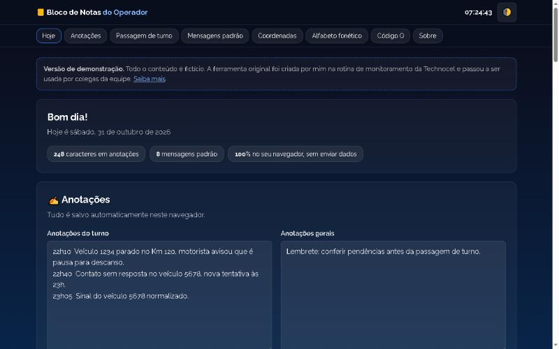

# Bloco de Notas do Operador (demo)

Ferramenta web para operadores de monitoramento, criada por mim na rotina da **Technocel Gerenciamento de Risco** e adotada por colegas da equipe como instrumento de trabalho.

Esta é uma **versão de demonstração, reescrita do zero**, com conteúdo fictício. Ela não contém dados, manuais, procedimentos, ramais ou nomes de clientes da empresa.

**Ver online:** https://hugohendrix.github.io/bloco-de-notas-demo/



## Por que existe

No monitoramento, o operador precisa anotar, passar o turno, responder motoristas com mensagens padronizadas e converter coordenadas sem perder tempo. Eu juntei essas tarefas em uma única página. Os colegas começaram a usar, e a ferramenta virou parte da rotina da equipe.

## Recursos

- **Anotações** com salvamento automático no navegador, botão de copiar e download em `.txt`.
- **Passagem de turno:** preencha operador, turno, sistema e pendências, e o texto sai montado para copiar.
- **Mensagens padrão** com busca e campos de veículo, local e horário que preenchem o texto.
- **Conversor de coordenadas:** aceita ponto ou vírgula decimal, valida os valores, gera o formato de mapa e o de planilha e abre no mapa.
- **Alfabeto fonético da OTAN:** digite uma placa e veja a soletração.
- **Código Q** com busca.
- **Relógio e saudação**, tema claro e escuro e botão de voltar ao topo.

## Decisões técnicas

- **HTML, CSS e JavaScript puros**, sem bibliotecas. A versão original usava Bootstrap, jQuery, Owl Carousel, AOS e Font Awesome, e a demo funciona com cerca de 30 KB de código próprio.
- **Privacidade:** tudo roda no navegador, e os dados ficam em `localStorage`. Nada é enviado a servidor algum.
- **Acessibilidade:** link para pular ao conteúdo, rótulos em todos os campos, foco visível, avisos para leitores de tela (`aria-live`) e navegação completa pelo teclado.
- **Responsivo**, testado a partir de 375 px, sem rolagem lateral.
- **Resiliente:** se o `localStorage` estiver bloqueado, a página avisa e continua funcionando. A cópia usa um plano B para navegadores sem a API de área de transferência.
- **SEO:** título e descrição próprios, Open Graph, Twitter Card, `canonical`, `robots.txt` e `sitemap.xml`.

## Como rodar

Não há etapa de build. Abra o `index.html` no navegador ou use um servidor local:

```bash
python -m http.server 8000
```

Depois acesse http://localhost:8000.

## Estrutura

```
index.html      página única com todas as seções
css/style.css   estilos, temas claro e escuro
js/script.js    anotações, passagem de turno, mensagens, coordenadas, alfabeto e código Q
img/            favicon e imagem de compartilhamento
```

## Autor

**Hugo Hendrix** · [Portfólio](https://hugohendrix.github.io/portfolio-hugo/) · [LinkedIn](https://www.linkedin.com/in/hugohendrix/) · [GitHub](https://github.com/HugoHendrix)
